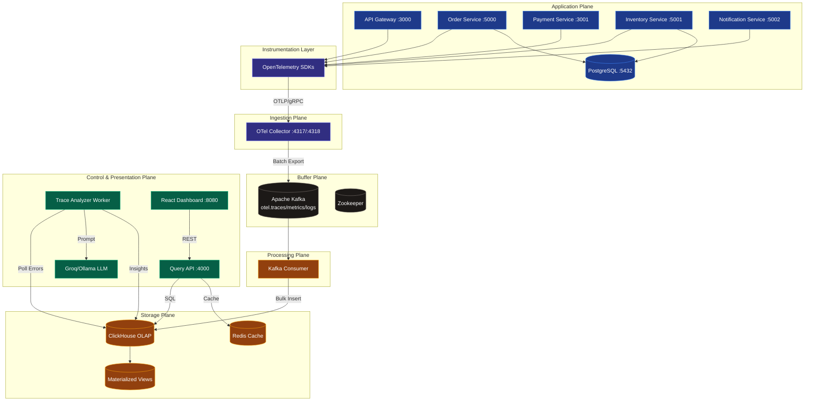
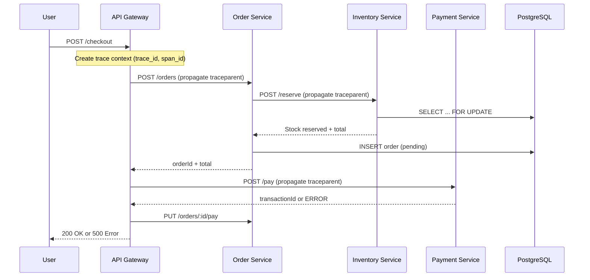
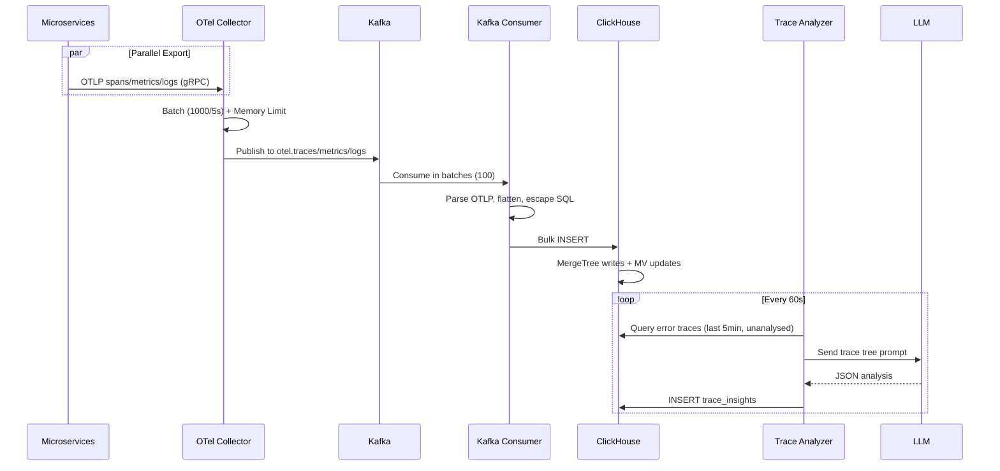
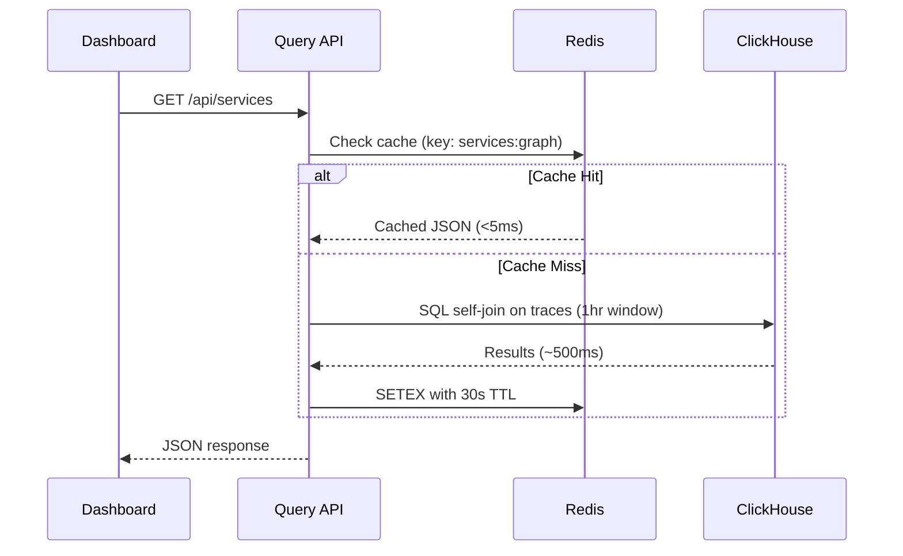

<div align="center">

# 🏛️ System Architecture Guide

### *Deep Dive into TraceLens Distributed Observability Platform*

[](.)
[](https://opentelemetry.io/)
[](https://clickhouse.com/)

*Comprehensive technical breakdown of components, data flows, and design patterns*

</div>

---

## 📑 Table of Contents

- [Overview](#-overview)
- [Design Philosophy](#-design-philosophy)
- [System Architecture](#-system-architecture)
- [Five-Layer Architecture](#-five-layer-architecture)
- [Data Flow Deep Dive](#-data-flow-deep-dive)
- [Component Architecture](#-component-architecture)
- [Technology Stack](#-technology-stack)
- [Scalability & Reliability](#-scalability--reliability)
- [Security Considerations](#-security-considerations)
- [Design Patterns Used](#-design-patterns-used)
- [References](#-references)

---

## 🎯 Overview

TraceLens is a **production-grade, self-hosted distributed tracing and observability platform** that implements the same architectural patterns as commercial APM solutions like Datadog, Honeycomb, and New Relic. Built with open-source technologies, it provides end-to-end request tracing, real-time analytics, service dependency mapping, and AI-powered root cause analysis.

The platform demonstrates real-world distributed systems engineering challenges including **backpressure handling, decoupled data pipelines, columnar analytics, context propagation, and intelligent incident triage**.

---

## 💡 Design Philosophy

| Principle | Implementation | Rationale |
|:-----------|:---------------|:-----------|
| **Separation of Concerns** | Five distinct planes (App, Ingestion, Buffer, Storage, Control) | Each component has single responsibility, independently scalable |
| **Loose Coupling** | Kafka as intermediary between collector and storage | Application performance isolated from telemetry pipeline failures |
| **Asynchronous by Default** | Fire-and-forget OTLP exports, background AI analysis | Zero impact on request latency from observability overhead |
| **Fail-Safe Design** | Memory limits, health checks, retry logic | Bounds resource use; note that `query-api` still requires Redis at startup |
| **Observability of Observability** | All components instrumented with OpenTelemetry | Platform can trace its own behavior |
| **Open Standards** | W3C Trace Context, OpenTelemetry protocols | Vendor-neutral, future-proof architecture |

---

## 🏗️ System Architecture

### High-Level Architecture Diagram



---

## 🔍 Five-Layer Architecture

### Layer 1: Application Plane
The **business logic layer** simulating a realistic e-commerce checkout flow.

| Service | Port | Technology | Purpose |
|:---------|:------|:------------|:--------|
| **api-gateway** | 3000 | Node.js + Express | Entry point, request orchestration, saga coordination |
| **order-service** | 5000 | Node.js + Express + PostgreSQL | Order lifecycle management, transaction coordination |
| **payment-service** | 3001 | Node.js + Express | Payment processing with simulated gateway (10% failure rate) |
| **inventory-service** | 5001 | Node.js + Express + PostgreSQL | Stock management with row-level locking, 10% failure rate |
| **notification-service** | 5002 | Node.js + Express | Email/notification dispatch with simulated SMTP (10% failure rate) |

**Key Characteristics:**
- All services auto-instrumented via OpenTelemetry
- W3C Trace Context propagated across HTTP calls
- Intentional chaos injection for realistic failure scenarios
- Graceful degradation with mock fallbacks for external dependencies

### Layer 2: Ingestion Plane
Handles **telemetry collection and normalization**.

| Component | Port | Configuration | Purpose |
|:-----------|:------|:---------------|:--------|
| **OpenTelemetry Collector (Contrib)** | 4317 (gRPC), 4318 (HTTP) | `otelcol-config.yaml` | Centralized telemetry receiver, processor, and exporter |
| **OTel SDKs** | Embedded | `services/tracing.js` | Auto-instrumentation for Node.js services |

**Collector Pipeline:**
```yaml
Receivers: [otlp] → Processors: [memory_limiter, batch, resource] → Exporters: [kafka/traces, kafka/metrics, kafka/logs]
```

**Processor Details:**
- **memory_limiter**: Caps at 256 MiB with 128 MiB spike limit - prevents OOM
- **batch**: 1000 spans/5s timeout - optimizes network efficiency
- **resource**: Adds `service.namespace=observability-platform` to all telemetry

### Layer 3: Buffer Plane
Provides **durable, decoupled message queuing**.

| Component | Port | Purpose |
|:-----------|:------|:--------|
| **Apache Kafka (Confluent)** | 9092 | Distributed event streaming platform for telemetry buffering |
| **Zookeeper** | 2181 | Kafka cluster coordination |

**Topics:**
- `otel.traces` - Distributed trace spans
- `otel.metrics` - Time-series metrics
- `otel.logs` - Structured log records

**Design Rationale:** Kafka acts as a shock absorber during traffic spikes, outages, or ClickHouse slowdowns, and application performance is isolated from storage backend health. It does **not** currently guarantee delivery: the consumer auto-commits offsets and discards a batch if the ClickHouse insert fails (see [Reliability Patterns](#reliability-patterns)).

### Layer 4: Processing & Storage Plane
Handles **data transformation, persistence, and optimization**.

| Component | Port | Purpose |
|:-----------|:------|:--------|
| **Kafka Consumer** | N/A | Parses OTLP JSON, flattens structures, bulk inserts to ClickHouse |
| **ClickHouse 24.3** | 8123 (HTTP), 9000 (Native) | Columnar OLAP database for high-performance analytics |
| **Redis 7** | 6379 | In-memory cache for expensive queries |

**ClickHouse Optimization Strategy:**
- **MergeTree Engine**: Append-optimized, sorted by (ServiceName, StartTime)
- **Partitioning**: Daily partitions by `toYYYYMMDD(StartTime)` for efficient TTL and pruning
- **LowCardinality**: Dictionary encoding for high-cardinality categorical fields
- **Materialized Views**: Pre-aggregated percentiles using `AggregatingMergeTree`
- **TTL Policies**: Automatic data expiration (traces: 30d, metrics: 7d, logs: 14d)

### Layer 5: Control & Presentation Plane
Provides **querying, AI analysis, and visualization**.

| Component | Port | Purpose |
|:-----------|:------|:--------|
| **Query API** | 4000 | REST interface, SQL generation, Redis caching |
| **Trace Analyzer Worker** | N/A | Background LLM-powered root cause analysis |
| **LLM (Groq/Ollama)** | External/11434 | AI inference for incident analysis |
| **React Dashboard** | 8080 | Interactive UI with 4 views |

---

## 🌊 Data Flow Deep Dive

### Request Flow (Critical Path)


### Telemetry Flow (Async, Non-Blocking)


### Query Flow (Read Path)


---

## 🧩 Component Architecture

### OpenTelemetry SDK Integration (`services/tracing.js`)

```javascript
// Initialization flow
1. Create Resource with SERVICE_NAME
2. Setup TraceExporter (OTLP gRPC)
3. Setup MetricExporter + PeriodicExportingMetricReader (10s interval)
4. Setup LoggerProvider + BatchLogRecordProcessor + OTLPLogExporter
5. Initialize NodeSDK with auto-instrumentations
6. Start SDK before app code loads (--import flag)
7. Export logError() helper for manual error logging
```

**Auto-Instrumented:** Express, HTTP/HTTPS, DNS, Net, PostgreSQL (pg), Axios calls, etc.

### Kafka Consumer (`kafka-consumer/`)

**Parsing Strategy:**
- `parseTraceMessage()`: Walks `resourceSpans[] → scopeSpans[] → spans[]`
- `parseMetricsMessage()`: Handles gauge, sum, histogram (expanded to .sum/.count)
- `parseLogsMessage()`: Extracts log records with trace correlation

**Batching Logic:**
- In-memory arrays: `tracesBatch`, `metricsBatch`, `logsBatch`
- Flush triggers: batch size >= 100 OR interval 5000ms
- On flush: swap array, process, clear original (prevents blocking)

**SQL Generation:**
- Uses `escSql()` for string escaping (prevents injection)
- Uses `attributesToMapSql()` returning `map('k1','v1','k2','v2')` syntax
- Posts directly to ClickHouse HTTP interface with `text/plain`

### Query API (`query-api/index.js`)

**Caching Strategy:**
```javascript
async function cachedQuery(key, query, ttl = 30) {
  // 1. Try Redis
  const cached = await redis.get(key);
  if (cached) return JSON.parse(cached);
  
  // 2. Query ClickHouse
  const result = await queryClickHouse(query);
  
  // 3. Store in Redis
  await redis.setEx(key, ttl, JSON.stringify(result));
  
  return result;
}
```

**Route Patterns:**
- All routes validate inputs, escape SQL
- ClickHouse 24.x uses POST body with `FORMAT JSON` appended
- Special header: `formatdatetime_parsedatetime_m_is_month_name=0` for date formatting
- Error handling returns 503 with details on failure

### Trace Analyzer (`query-api/workers/trace-analyser.js`)

**Analysis Pipeline:**
```javascript
1. Query: Find error traces (StatusCode=2) in last 5min
   - NOT in trace_insights (already analysed)
   - NOT in analysis_attempts with >=3 attempts
2. For each trace: Build prompt with all spans
3. Call LLM (Groq/Ollama/Mock) with JSON schema
4. Parse response, validate
5. Store in trace_insights OR record attempt
6. Throttle: 1s (Groq) / 2s (Ollama)
7. Repeat every 60s
```

**Prompt Engineering:**
- System role: Distributed systems expert
- Structured span list with duration, status, errors
- Forced JSON response schema
- Temperature 0.3 for deterministic output

---

## 💻 Technology Stack

| Category | Technology | Version | Purpose |
|:-----------|:------------|:---------|:--------|
| **Language (Backend)** | Node.js | 20.19+ | Services, API, Consumer; dashboard tooling (Vite 8 / ESLint 10) requires 20.19+ |
| **Language (Frontend)** | TypeScript + React | 19 + 18 | Dashboard UI |
| **Framework (API)** | Express.js | 4.x | REST APIs |
| **Tracing** | OpenTelemetry | Latest | Instrumentation & propagation |
| **Message Queue** | Apache Kafka (Confluent) | 7.5.3 | Telemetry buffering |
| **OLAP Database** | ClickHouse | 24.3 | Trace storage & analytics |
| **Cache** | Redis | 7 Alpine | Query result caching |
| **RDBMS** | PostgreSQL | 15 Alpine | Application data (orders/inventory) |
| **AI/LLM** | Groq (Llama 3.1) / Ollama (Llama 3/TinyLlama) | - | Root cause analysis |
| **Frontend Build** | Vite | Latest | Fast dev/build |
| **UI Components** | TailwindCSS 4 | Latest | Styling |
| **Charts** | Recharts | Latest | Metrics visualization |
| **Graph** | React Flow + Dagre | Latest | Service dependency graph |
| **Containerization** | Docker + Docker Compose | v2+ | Orchestration |

---

## 📈 Scalability & Reliability

### Horizontal Scalability

| Component | Scaling Strategy | Notes |
|:-----------|:-----------------|:-------|
| **OTel Collectors** | Load balancer + multiple instances | Stateless, linear scaling |
| **Kafka** | Add brokers, increase partitions | Key for parallel consumption |
| **Kafka Consumers** | Scale consumer group | Up to partition count |
| **ClickHouse** | Sharding + Replication | Distributed tables for HA |
| **Query API** | Multiple replicas behind LB | Stateless, Redis-shared |
| **Trace Analyzer** | Partition by trace hash | Parallel LLM processing |

### Reliability Patterns

| Pattern | Implementation | Benefit |
|:---------|:---------------|:---------|
| **Circuit Breaker** | Implicit via timeouts/retries | Prevents cascade failures |
| **Bulkhead** | Separate containers/networks | Isolated failure domains |
| **Timeout** | Axios timeouts (5-30s), ClickHouse 10s | Bounded wait times |
| **Retry with Backoff** | Kafka exporter retry config | Handles transient failures |
| **Health Checks** | Docker healthchecks on all critical services | Orchestration awareness |
| **Graceful Shutdown** | SIGINT/SIGTERM handlers | Clean resource cleanup |
| **No Delivery Guarantee (known limitation)** | Offsets auto-commit per message; in-memory batches are dropped if the ClickHouse insert fails | Data can be lost on a ClickHouse blip or consumer restart, duplicates are possible, and there is no `TraceId`+`SpanId` deduplication |

### Performance Characteristics

| Metric | Target | Actual (Typical) |
|:--------|:--------|:-----------------|
| **Ingestion Rate** | >500 spans/sec | 1000+ spans/sec |
| **Trace Query (by ID)** | <50ms | 10-30ms (cached) |
| **Service Graph (cached)** | <5ms | <2ms |
| **Service Graph (cold)** | <500ms | 200-400ms |
| **Dashboard Load** | <1s | <500ms |
| **LLM Analysis** | <30s | 2s (Groq) / 10s (Ollama) |

---

## 🔒 Security Considerations

> ⚠️ **Important:** This is a development/demo platform. Additional hardening required for production exposure.

### Current Security Posture

| Area | Status | Notes |
|:------|:--------|:-------|
| **JWT Auth (API Gateway)** | Weak | Hardcoded secret `'secret_key'`, mock user fallback |
| **Query API** | None | No authentication/authorization |
| **Dashboard** | None | Publicly accessible if exposed |
| **ClickHouse** | Basic | Username/password in docker-compose |
| **Secrets** | Env vars | Loaded from `.env`, gitignored |
| **SQL Injection** | Mitigated | Inputs escaped via the shared [`escSql()`](../shared/sql-utils.js) helper |
| **Network** | Isolated | Bridge network for internal comms |

### Production Hardening Recommendations

- [ ] Replace hardcoded JWT secret with env var, enforce auth
- [ ] Add API authentication (JWT/API keys) to Query API
- [ ] Implement rate limiting on all public endpoints
- [ ] Enable TLS for all inter-service communication
- [ ] Use secrets manager (Vault/AWS Secrets Manager)
- [ ] Add CORS restrictions (currently `cors()` allows all)
- [ ] Implement RBAC for dashboard access
- [ ] Enable audit logging
- [ ] Add WAF/reverse proxy with security headers
- [ ] Rotate credentials regularly

---

## 🎨 Design Patterns Used

| Pattern | Where Used | Purpose |
|:---------|:-----------|:--------|
| **Saga Pattern** | API Gateway checkout flow | Distributed transaction coordination |
| **Producer-Consumer** | Kafka + Consumer | Decoupled async processing |
| **Circuit Breaker** | HTTP calls with try/catch | Failure isolation |
| **CQRS-lite** | Write path (Kafka) vs Read path (API) | Optimized for different workloads |
| **Materialized View** | ClickHouse MV for percentiles | Pre-computation for performance |
| **Cache-Aside** | Redis in Query API | Lazy loading with TTL |
| **Background Worker** | Trace Analyzer | Async processing without blocking |
| **Adapter Pattern** | OTLP parsers | Normalize different telemetry formats |
| **Singleton** | SDK instances, Redis client | Shared resources |
| **Dependency Injection** | Environment variables | Configurable components |

---

## 📚 References

- [OpenTelemetry Documentation](https://opentelemetry.io/docs/)
- [W3C Trace Context](https://www.w3.org/TR/trace-context/)
- [Apache Kafka Documentation](https://kafka.apache.org/documentation/)
- [ClickHouse Documentation](https://clickhouse.com/docs)
- [Redis Documentation](https://redis.io/docs/)
- [OTLP Specification](https://opentelemetry.io/docs/specs/otlp/)

---

<div align="center">

**[← Back to README](../README.md)** | **[Installation Guide →](./installation-guide.md)**

</div>
