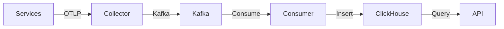

<div align="center">

# 📈 Monitoring & Observability Operations Guide

### *Operating the Observability Platform*

[](.)
[](.)

*Guide for monitoring and operating TraceLens in production*

</div>

---

## 📑 Table of Contents

- [Overview](#overview)
- [Health Monitoring](#health-monitoring)
- [Performance Monitoring](#performance-monitoring)
- [Data Pipeline Monitoring](#data-pipeline-monitoring)
- [Alerting](#alerting)
- [Logging & Log Analysis](#logging--log-analysis)
- [Capacity Planning](#capacity-planning)
- [Incident Response](#incident-response)
- [Maintenance Procedures](#maintenance-procedures)
- [Runbooks](#runbooks)
- [Metrics Dashboard](#metrics-dashboard)

---

## 🎯 Overview

This guide covers operational aspects of running TraceLens - monitoring health, performance, and data flow, plus incident response procedures.

---

## 💚 Health Monitoring

### Service Health Checks

| Service | Endpoint | Expected | Critical |
|:----------|:-----------|:----------|:----------|
| **API Gateway** | `http://localhost:3000/health` | `{"status":"healthy"}` | Yes |
| **Order Service** | `http://localhost:5000/health` | `{"status":"healthy"}` | Yes |
| **Payment Service** | `http://localhost:3001/health` | `{"status":"healthy"}` | Yes |
| **Inventory Service** | `http://localhost:5001/health` | `{"status":"healthy"}` | Yes |
| **Notification Service** | `http://localhost:5002/health` | `{"status":"healthy"}` | Yes |
| **Query API** | `http://localhost:4000/health` | `{"status":"healthy"}` | Yes |
| **ClickHouse** | `http://localhost:8123/ping` | `Ok.` | Yes |
| **Redis** | `redis-cli ping` | `PONG` | Yes |
| **Kafka** | Broker API check | Connected | Yes |

### Automated Health Check Script
```bash
#!/bin/bash
services=("http://localhost:3000/health" "http://localhost:4000/health" "http://localhost:5000/health")
for url in "${services[@]}"; do
  if curl -f -s "$url" > /dev/null; then
    echo "✓ $url OK"
  else
    echo "✗ $url FAILED"
  fi
done
```

### Docker Health Status
```bash
docker compose ps --format "table {{.Name}}\t{{.Status}}\t{{.State}}"
```

---

## ⚡ Performance Monitoring

### Key Performance Indicators

| KPI | Target | Warning | Critical | Measurement |
|:----|:--------|:---------|:----------|:-------------|
| **API Response Time** | <100ms | >200ms | >500ms | Query API latency |
| **Trace Ingestion Rate** | >500/s | <300/s | <100/s | Spans/second |
| **ClickHouse Query Time** | <50ms | >100ms | >500ms | Dashboard queries |
| **Redis Hit Rate** | >80% | <60% | <40% | Cache effectiveness |
| **Kafka Lag** | <1000 | >5000 | >10000 | Consumer lag |
| **Memory Usage** | <70% | >80% | >90% | Container memory |
| **CPU Usage** | <70% | >80% | >90% | Container CPU |

### Monitoring Commands

```bash
# Container resources
docker stats --no-stream

# ClickHouse performance
docker compose exec clickhouse clickhouse-client --user default --password password \
  --query "SELECT * FROM system.metrics WHERE metric LIKE '%Memory%' OR metric LIKE '%CPU%'"

# Kafka lag
docker compose exec kafka kafka-consumer-groups --bootstrap-server kafka:9092 \
  --describe --group otel-consumer-group

# Redis stats
docker compose exec redis redis-cli INFO stats
```

---

## 🔄 Data Pipeline Monitoring

### Pipeline Health Check



### Monitoring Points

| Stage | Metric | Check Command |
|:--------|:--------|:--------------|
| **Instrumentation** | Spans being sent | Check service logs for OTel |
| **Collector** | Batches exported | `docker compose logs otel-collector \| grep -i batch` |
| **Kafka** | Topic depth | Consumer lag check |
| **Consumer** | Inserts successful | `docker compose logs kafka-consumer \| grep -i inserted` |
| **ClickHouse** | Row counts | Query count from tables |
| **API** | Query success | Check API logs |

### Data Freshness
```sql
-- Check latest traces
SELECT max(StartTime) FROM traces;

-- Check lag
SELECT now() - max(StartTime) as lag_seconds FROM traces;
```

---

## 🚨 Alerting

### Alert Rules

| Alert | Condition | Severity | Action |
|:--------|:-----------|:----------|:--------|
| **Service Down** | Health check fails | Critical | Restart service, investigate |
| **High Error Rate** | >10% errors in 5min | Critical | Check traces, AI insights |
| **High Latency** | P99 > 2000ms | High | Check dependencies |
| **Kafka Lag** | >10000 messages | High | Scale consumers |
| **Disk Full** | >90% usage | Critical | Clean old data or expand |
| **Memory High** | >90% for 5min | High | Investigate or scale |
| **ClickHouse Down** | Unreachable | Critical | Restart, check data |

### Alert Implementation Ideas
- Uptime monitoring (external)
- Custom scripts with notifications
- Prometheus Alertmanager
- Grafana alerts

---

## 📝 Logging & Log Analysis

### Log Locations
```bash
# All logs
docker compose logs

# Specific service
docker compose logs -f query-api

# Export logs
docker compose logs > logs-$(date +%Y%m%d).txt
```

### Log Levels to Watch
- **ERROR** - Critical issues
- **WARN** - Potential problems
- **INFO** - Normal operations

### Common Log Patterns

**Healthy:**
```
✓ Connected to Kafka
✓ Inserted 100 traces into ClickHouse
✓ Redis connected
```

**Problems:**
```
✗ Failed to insert traces
Error querying ClickHouse
ECONNREFUSED
```

---

## 📊 Capacity Planning

### Resource Sizing Guide

| Workload | CPU | RAM | Disk | Notes |
|:-----------|:-----|:-----|:------|:-------|
| **Light (<100 spans/s)** | 2 cores | 4GB | 20GB | Dev/demo |
| **Medium (100-500/s)** | 4 cores | 8GB | 50GB | Small prod |
| **Heavy (500-1000/s)** | 8 cores | 16GB | 100GB | Production |

### Growth Estimates
- Traces: ~1KB per span average
- 10K spans/hour = ~10MB/hour = ~240MB/day
- With TTL 30 days = ~7GB
- ClickHouse compression ~70% = ~2GB

### Scaling Triggers
- Disk > 80%
- Memory consistently > 80%
- CPU > 80% sustained
- Kafka lag increasing
- Query times increasing

---

## 🚑 Incident Response

### Incident Severity Levels

| Level | Description | Response Time | Example |
|:--------|:-------------|:--------------|:---------|
| **P0** | Complete outage | Immediate | All services down |
| **P1** | Major degradation | <30 min | High error rate, data loss |
| **P2** | Partial degradation | <2 hours | Slow queries, some errors |
| **P3** | Minor issue | <4 hours | UI glitch, warnings |

### Incident Response Workflow

1. **Detect** - Alert triggered or reported
2. **Acknowledge** - Confirm incident
3. **Investigate** - Use traces, logs, metrics
4. **Mitigate** - Apply fix/workaround
5. **Resolve** - Verify fix
6. **Post-Mortem** - Document learnings

### Quick Troubleshooting

```bash
# Restart everything
docker compose restart

# Check dependencies
docker compose ps

# View errors
docker compose logs | grep -A 5 -B 5 ERROR

# Check disk space
df -h

# Check network
docker network inspect infra_observability
```

---

## 🔧 Maintenance Procedures

### Daily
- [ ] Check service health
- [ ] Review error rates
- [ ] Check disk space
- [ ] Review logs for errors

### Weekly
- [ ] Review performance metrics
- [ ] Check backups
- [ ] Update containers if needed
- [ ] Review security logs
- [ ] Clean up old logs

### Monthly
- [ ] Update dependencies
- [ ] Review capacity
- [ ] Test disaster recovery
- [ ] Security audit
- [ ] Optimize ClickHouse (OPTIMIZE TABLE)

### ClickHouse Maintenance
```sql
-- Optimize tables
OPTIMIZE TABLE traces FINAL;
OPTIMIZE TABLE metrics FINAL;

-- Check table sizes
SELECT table, formatReadableSize(sum(bytes)) as size
FROM system.parts
WHERE active
GROUP BY table;
```

---

## 📚 Runbooks

### Runbook: High Error Rate
1. Check alerts dashboard
2. Identify affected service
3. View error traces
4. Check AI insights
5. Review service logs
6. Check dependencies
7. Scale or restart if needed

### Runbook: Kafka Lag
1. Check consumer lag
2. Verify consumer running
3. Check ClickHouse inserts
4. Scale consumers
5. Monitor lag decreasing

### Runbook: ClickHouse Down
1. Check container status
2. View logs
3. Restart ClickHouse
4. Verify data intact
5. Restart consumers
6. Check pipeline

### Runbook: Out of Disk Space
1. Check disk usage
2. Review TTL policies
3. Manually delete old data if needed
4. Expand disk
5. Implement log rotation

---

## 📊 Metrics Dashboard

### Built-in Metrics (Dashboard UI)
- Total requests
- Error rate
- P99 latency
- Service graph
- Trace explorer
- AI insights

### Recommended External Monitoring
- **Prometheus** - Metrics collection
- **Grafana** - Visualization
- **Node Exporter** - Host metrics
- **cAdvisor** - Container metrics

---

<div align="center">

**[← Back to Docs](../README.md)** | **[Testing Guide →](./testing-guide.md)**

</div>
