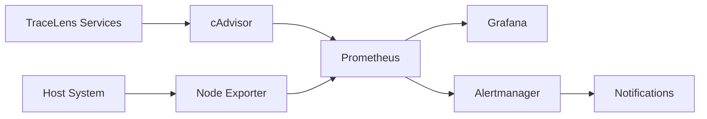

<div align="center">

# 📊 Prometheus & Grafana Setup Guide

### *Metrics Collection and Visualization*

[](https://prometheus.io/)
[](https://grafana.com/)

*Setting up external monitoring for TraceLens*

</div>

---

## 📑 Table of Contents

- [Overview](#-overview)
- [Architecture](#-architecture)
- [Prerequisites](#-prerequisites)
- [Installing Prometheus](#-installing-prometheus)
- [Prometheus Configuration](#prometheus-configuration)
- [Installing Grafana](#-installing-grafana)
- [Configuring Node Exporter](#-configuring-node-exporter)
- [Configuring cAdvisor](#-configuring-cadvisor)
- [Grafana Dashboards](#-grafana-dashboards)
- [Alerting Rules](#-alerting-rules)
- [Docker Compose Integration](#-docker-compose-integration)
- [Troubleshooting](#-troubleshooting)

---

## 🎯 Overview

While TraceLens has built-in observability, integrating Prometheus and Grafana provides additional infrastructure monitoring, custom alerts, and unified dashboards for production environments.

---

## 🏗️ Architecture



---

## ✅ Prerequisites

- TraceLens stack running
- Additional resources (1-2GB RAM recommended)
- Ports 9090 (Prometheus), 3002 (Grafana), 9100 (Node Exporter), 8081 (cAdvisor) available. Avoid `3001` (payment-service) and `8080` (dashboard).

---

## 🚀 Installing Prometheus

### Using Docker

```bash
docker run -d \
  --name prometheus \
  -p 9090:9090 \
  -v $(pwd)/prometheus.yml:/etc/prometheus/prometheus.yml \
  prom/prometheus:latest
```

## Prometheus Configuration

### Configuration File (`prometheus.yml`)

```yaml
global:
  scrape_interval: 15s
  evaluation_interval: 15s

alerting:
  alertmanagers:
    - static_configs:
        - targets:
          - alertmanager:9093

rule_files:
  - "alert_rules.yml"

scrape_configs:
  - job_name: 'prometheus'
    static_configs:
      - targets: ['localhost:9090']

  - job_name: 'node-exporter'
    static_configs:
      - targets: ['node-exporter:9100']

  - job_name: 'cadvisor'
    static_configs:
      - targets: ['cadvisor:8080']
```

> Application services (`api-gateway`, `query-api`, `order-service`, etc.) push OTLP to the collector and do **not** expose a `/metrics` endpoint. Do not add them as Prometheus scrape targets unless you add a Prometheus exporter; otherwise those targets stay down and trigger false alerts.

---

## 📊 Installing Grafana

### Using Docker

```bash
docker run -d \
  --name grafana \
  -p 3002:3000 \
  -e "GF_SECURITY_ADMIN_PASSWORD=admin" \
  -v grafana-data:/var/lib/grafana \
  grafana/grafana:latest
```

### Initial Setup
1. Access `http://localhost:3002`
2. Login with admin/admin
3. Change password
4. Add Prometheus as data source: `http://prometheus:9090`

---

## 🖥️ Configuring Node Exporter

```bash
docker run -d \
  --name node-exporter \
  -p 9100:9100 \
  --pid="host" \
  -v "/:/host:ro,rslave" \
  prom/node-exporter:latest \
  --path.rootfs=/host
```

---

## 📦 Configuring cAdvisor

```bash
docker run -d \
  --name cadvisor \
  -p 8081:8080 \
  -v /:/rootfs:ro \
  -v /var/run:/var/run:ro \
  -v /sys:/sys:ro \
  -v /var/lib/docker/:/var/lib/docker:ro \
  gcr.io/cadvisor/cadvisor:latest
```

---

## 📈 Grafana Dashboards

### Recommended Dashboards

| Dashboard ID | Name | Purpose |
|:--------------|:------|:---------|
| **1860** | Node Exporter Full | Host metrics (CPU, RAM, Disk, Network) |
| **893** | Docker and System Monitoring | Container metrics via cAdvisor |
| **14282** | Cadvisor exporter | Detailed container stats |
| **3662** | Prometheus 2.0 Stats | Prometheus health |

### Import Dashboard
1. Go to Grafana → Dashboards → Import
2. Enter Dashboard ID
3. Select Prometheus data source
4. Import

### Custom TraceLens Dashboard

Create panels for:
- Request rate per service
- Error rate percentage
- P50/P95/P99 latency
- Active traces
- Kafka consumer lag
- ClickHouse queries

---

## 🚨 Alerting Rules

Create `alert_rules.yml`:

```yaml
groups:
  - name: tracelens_alerts
    interval: 30s
    rules:
      - alert: HighMemoryUsage
        expr: (node_memory_MemTotal_bytes - node_memory_MemAvailable_bytes) / node_memory_MemTotal_bytes * 100 > 90
        for: 5m
        labels:
          severity: warning
        annotations:
          summary: "High memory usage"
          description: "Memory usage is above 90%"

      - alert: HighCPUUsage
        expr: 100 - (avg by(instance) (irate(node_cpu_seconds_total{mode="idle"}[5m])) * 100) > 90
        for: 5m
        labels:
          severity: warning
        annotations:
          summary: "High CPU usage"
          description: "CPU usage is above 90%"

      - alert: DiskSpaceLow
        expr: (node_filesystem_avail_bytes / node_filesystem_size_bytes) * 100 < 10
        for: 5m
        labels:
          severity: critical
        annotations:
          summary: "Disk space low"
          description: "Less than 10% disk space remaining"
```

---

## 🐋 Docker Compose Integration

Add to `infra/docker-compose.yml`:

```yaml
  prometheus:
    image: prom/prometheus:latest
    ports:
      - "9090:9090"
    volumes:
      - ./monitoring/prometheus.yml:/etc/prometheus/prometheus.yml
      - ./monitoring/alert_rules.yml:/etc/prometheus/alert_rules.yml
      - prometheus_data:/prometheus
    networks:
      - observability

  grafana:
    image: grafana/grafana:latest
    ports:
      - "3002:3000"
    environment:
      - GF_SECURITY_ADMIN_PASSWORD=admin
    volumes:
      - grafana_data:/var/lib/grafana
    networks:
      - observability
    depends_on:
      - prometheus

  node-exporter:
    image: prom/node-exporter:latest
    ports:
      - "9100:9100"
    volumes:
      - /proc:/host/proc:ro
      - /sys:/host/sys:ro
      - /:/rootfs:ro
    command:
      - '--path.procfs=/host/proc'
      - '--path.sysfs=/host/sys'
      - '--collector.filesystem.mount-points-exclude=^/(sys|proc|dev|host|etc)($$|/)'
    networks:
      - observability

  cadvisor:
    image: gcr.io/cadvisor/cadvisor:latest
    ports:
      - "8081:8080"
    volumes:
      - /:/rootfs:ro
      - /var/run:/var/run:ro
      - /sys:/sys:ro
      - /var/lib/docker/:/var/lib/docker:ro
    networks:
      - observability

volumes:
  prometheus_data:
  grafana_data:
```

---

## 🔍 Troubleshooting

| Issue | Solution |
|:-------|:----------|
| **Prometheus can't scrape targets** | Check network connectivity, service names |
| **Grafana can't connect to Prometheus** | Use container name as host |
| **No data in dashboards** | Verify targets are up in Prometheus (Status → Targets) |
| **High cardinality** | Limit metrics collection |
| **Permission issues** | Check volume permissions |

---

<div align="center">

**[← Back to Monitoring](./monitoring-operations.md)** | **[Troubleshooting →](../troubleshooting.md)**

</div>
