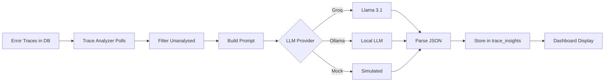

<div align="center">

# 📊 Observability Guide

### *Understanding Tracing, Metrics, Logging & AI Analysis*

[](https://opentelemetry.io/)
[](.)
[](.)

*Comprehensive guide to observability concepts in TraceLens*

</div>

---

## 📑 Table of Contents

- [What is Observability?](#-what-is-observability)
- [The Three Pillars](#-the-three-pillars)
- [Distributed Tracing Deep Dive](#-distributed-tracing-deep-dive)
- [Metrics & Performance Monitoring](#-metrics--performance-monitoring)
- [Logging & Correlation](#-logging--correlation)
- [Service Dependency Mapping](#-service-dependency-mapping)
- [AI-Powered Root Cause Analysis](#-ai-powered-root-cause-analysis)
- [Using the Dashboard](#-using-the-dashboard)
- [Querying Data Directly](#-querying-data-directly)
- [Best Practices](#-best-practices)
- [Advanced Topics](#-advanced-topics)

---

## 🎯 What is Observability?

**Observability** is the ability to understand the internal state of a system by examining its external outputs. In distributed systems, this means being able to answer questions like:

- *"Why is checkout failing for some users?"*
- *"Which service is causing the latency spike?"*
- *"How are requests flowing through my microservices?"*
- *"What's the root cause of this error?"*

TraceLens provides **full-stack observability** with correlation across all signals, enabling rapid debugging and incident resolution.

---

## 🏛️ The Three Pillars

| Pillar | Purpose | Implementation | Use Case |
|:--------|:---------|:----------------|:----------|
| **Traces** | Track request flow across services | OpenTelemetry spans → Kafka → ClickHouse | Debug specific user requests, understand dependencies |
| **Metrics** | Measure system behavior over time | OTel metrics → Aggregated in ClickHouse MVs | Monitor latency, throughput, error rates |
| **Logs** | Record discrete events with context | OTel logs with trace correlation → ClickHouse | Detailed debugging, audit trails |

All three pillars are **correlated** via `TraceId` and `SpanId`, allowing seamless navigation between them.

---

## 🔍 Distributed Tracing Deep Dive

### Core Concepts

| Concept | Definition | Example |
|:----------|:------------|:---------|
| **Trace** | End-to-end journey of a request through the system | Complete `POST /checkout` flow |
| **Span** | A single operation within a trace | HTTP call, DB query, function execution |
| **TraceId** | Unique identifier for entire trace (128-bit) | `a1b2c3d4e5f6...` |
| **SpanId** | Unique identifier for a single span (64-bit) | `1234567890abcdef` |
| **ParentSpanId** | Links child spans to parent | Creates call tree hierarchy |
| **Trace Context** | Propagation metadata (W3C traceparent) | Flows across service boundaries |

### W3C Trace Context Propagation

TraceLens uses the **W3C Trace Context** standard for cross-service propagation.

**Header Format:**
```http
traceparent: 00-<trace-id>-<span-id>-<trace-flags>
```

**Example:**
```http
traceparent: 00-4bf92f3577b34da6a3ce929d0e0e4736-00f067aa0ba902b7-01
```

**Components:**
- `00` - Version
- `4bf92f3577b34da6a3ce929d0e0e4736` - Trace ID (32 hex chars)
- `00f067aa0ba902b7` - Parent Span ID (16 hex chars)
- `01` - Trace flags (sampled)

### How Propagation Works in TraceLens

```javascript
// API Gateway propagates trace context
const tp = req.headers['traceparent'] || '';
await axios.post(`${ORDER_SERVICE_URL}/orders`, data, { 
  headers: { 'traceparent': tp }
});

// OpenTelemetry SDK auto-instruments and extracts/injects
```

**Auto-instrumentation** handles:
- HTTP client/server instrumentation
- Database query instrumentation (Postgres)
- Context extraction from incoming headers
- Context injection into outgoing requests

### Span Attributes

Each span captures rich metadata:

| Attribute | Type | Purpose |
|:-----------|:------|:---------|
| `http.method` | String | HTTP method (GET, POST, etc.) |
| `http.url` | String | Request URL |
| `http.status_code` | Number | HTTP response status |
| `db.system` | String | Database type (postgresql) |
| `db.statement` | String | SQL query (auto-captured) |
| `net.peer.name` | String | Remote host |
| `service.name` | String | Service that created span |

### Span Status Codes

| Code | Meaning | When Used |
|:------|:---------|:-----------|
| `0` | Unset | Default, no explicit status |
| `1` | OK | Successful operation |
| `2` | Error | Failed operation (exceptions, 5xx errors) |

### Trace Waterfall Visualization

The dashboard renders spans as a **waterfall chart** showing:
- **Timeline**: Horizontal bars positioned by start time
- **Duration**: Bar width proportional to span duration
- **Hierarchy**: Indentation shows parent-child relationships
- **Color Coding**: By service or status (red for errors)
- **Details**: Click span for attributes, status, timing

---

## 📈 Metrics & Performance Monitoring

### Key Metrics Tracked

| Metric | Type | Description | Alert Threshold |
|:--------|:------|:-------------|:-----------------|
| **Request Count** | Counter | Total requests per service per minute | N/A |
| **Error Count** | Counter | Failed requests (StatusCode=2) | N/A |
| **P50 Latency** | Histogram/Quantile | Median response time | >500ms (warning) |
| **P95 Latency** | Histogram/Quantile | 95th percentile | >1000ms |
| **P99 Latency** | Histogram/Quantile | 99th percentile | >2000ms |
| **Error Rate** | Calculated | (errors/total)*100 | >5% (high), >10% (critical) |

### Materialized View Architecture

The authoritative schema is defined in [`infra/clickhouse/init.sql`](../infra/clickhouse/init.sql). `service_latency_mv` stores quantile states per service per minute, and `service_latency` merges them at read time.

Important: the view exposes **`p50_ns`, `p95_ns`, and `p99_ns`** (nanoseconds, matching the raw `Duration` unit), not `*_ms`. Convert at query time, for example `p99_ns / 1000000 AS p99_ms`. It also exposes `total_requests`, `error_count`, and `error_rate_pct`.

**Benefits:**
- **Performance**: Pre-computed states, merge on read is cheap
- **Storage**: ~90% reduction vs storing raw spans for dashboards
- **Accuracy**: Quantiles over the aggregated window
- **Real-time**: Updates as new spans arrive

### Anomaly Detection

The `/api/alerts` endpoint identifies anomalies:

```sql
SELECT
  ServiceName,
  formatDateTime(Minute, '%Y-%m-%d %H:%M:%S') AS MinuteStr,
  p99_ns / 1000000 AS p99_ms,
  total_requests,
  error_count,
  error_rate_pct,
  if(error_rate_pct > 10, 'critical',
     if(error_rate_pct > 5, 'high', 'medium')) AS severity
FROM service_latency
WHERE Minute > now() - INTERVAL 1 HOUR
  AND (error_rate_pct > 5 OR p99_ns > 500000000)
ORDER BY Minute DESC
LIMIT 20;
```

**Triggers:**
- Error rate > 5% in last hour
- P99 latency > 500ms in last hour

---

## 📝 Logging & Correlation

### Structured Logging

Services use OpenTelemetry logging with trace correlation:

```javascript
// services/tracing.js
export function logError(message, err) {
  const logger = logs.getLogger(serviceName);
  const activeSpan = trace.getActiveSpan();
  const spanContext = activeSpan?.spanContext();
  
  logger.emit({
    severityNumber: SeverityNumber.ERROR,
    severityText: 'ERROR',
    body: err?.message ? `${message}: ${err.message}` : message,
    attributes: { 'error.type': err?.name || 'Error' },
    traceId: spanContext?.traceId,
    spanId: spanContext?.spanId,
  });
}
```

### Log Schema

```sql
CREATE TABLE logs (
  ServiceName    LowCardinality(String),
  Timestamp      DateTime64(9, 'UTC'),
  SeverityText   LowCardinality(String),
  SeverityNumber UInt8,
  Body           String,
  TraceId        String,
  SpanId         String,
  Attributes     Map(String, String)
) ENGINE = MergeTree()
ORDER BY (ServiceName, Timestamp)
PARTITION BY toYYYYMMDD(Timestamp)
TTL toDateTime(Timestamp) + INTERVAL 14 DAY;
```

### Correlation Workflow

1. **Error occurs** in service with active span
2. **logError() called** → emits log with traceId/spanId
3. **Log exported** via OTLP to collector → Kafka → ClickHouse
4. **In dashboard**: Click trace → see spans, can correlate with logs
5. **Query**: Find all logs for a traceId

**Example correlation query:**
```sql
SELECT * FROM logs WHERE TraceId = 'a1b2c3...' ORDER BY Timestamp;
```

---

## 🕸️ Service Dependency Mapping

### How It Works

The service graph is built from **span parent-child relationships** using a self-join:

```sql
CREATE VIEW service_dependencies AS
SELECT
  source.ServiceName AS source_service,
  source.OperationName AS source_operation,
  target.ServiceName AS target_service,
  target.OperationName AS target_operation,
  count() AS call_count,
  avg(target.Duration) AS avg_latency_ns,
  max(target.Duration) AS max_latency_ns,
  min(target.Duration) AS min_latency_ns,
  sum(if(target.StatusCode = 2, 1, 0)) AS error_count
FROM traces AS source
JOIN traces AS target ON 
  source.SpanId = target.ParentSpanId AND
  source.TraceId = target.TraceId
WHERE source.StartTime > now() - INTERVAL 1 HOUR
GROUP BY source_service, source_operation, target_service, target_operation
ORDER BY call_count DESC;
```

**Logic:**
- Find spans where `target.ParentSpanId = source.SpanId` (direct call)
- Same `TraceId` ensures same trace
- Aggregate over last hour
- Calculate call counts, latencies, errors

### Visualization

React Flow renders the graph with:
- **Nodes**: Services (sized by request volume)
- **Edges**: Dependencies (thickness by call count)
- **Colors**: Edge color based on latency
  - Green: < 200ms average
  - Amber: 200-500ms
  - Red: > 500ms
- **Layout**: Dagre auto-layout for clean hierarchy
- **Interactions**: Click node for service details

### Use Cases
- **Understand architecture** at a glance
- **Identify hot paths** and bottlenecks
- **Spot cascading failures** visually
- **Detect unexpected dependencies**
- **Capacity planning** insights

---

## 🤖 AI-Powered Root Cause Analysis

### Architecture



### Analysis Criteria

**Triggers for analysis:**
- `StatusCode = 2` (error)
- Created in last 5 minutes
- Not yet in `trace_insights` table
- Failed attempts < 3

### Prompt Engineering

```javascript
function buildPrompt(trace) {
  const spanList = trace.spans
    .map((span, idx) =>
      `${idx + 1}. [${span[2]}] ${span[3]} | Duration: ${span[4]}ms | Status: ${span[5]}${
        span[6] ? ` | Error: ${span[6]}` : ''
      }`
    )
    .join('\n');

  return `You are a distributed systems expert. Analyze this error trace from a microservices system and identify the root cause.

Trace ID: ${trace.TraceId}
Service: ${trace.ServiceName}
Operation: ${trace.OperationName}
Error: ${trace.StatusMessage || 'Unknown error'}

Spans (oldest to newest):
${spanList}

Respond in JSON only, no markdown, no explanation:
{
  "root_cause": "one sentence description of what went wrong",
  "impacted_services": ["service1", "service2"],
  "severity": "low|medium|high|critical",
  "recommendation": "one sentence actionable fix"
}`;
}
```

### Expected Response

```json
{
  "root_cause": "Payment service timed out calling external payment gateway after 5001ms due to network latency",
  "impacted_services": ["payment-service", "api-gateway"],
  "severity": "high",
  "recommendation": "Implement circuit breaker with 3s timeout and fallback to retry queue"
}
```

### Severity Levels

| Severity | Meaning | Priority | Typical Response |
|:-----------|:---------|:----------|:-----------------|
| **critical** | System-wide outage, data loss risk | P0 - Immediate | Page on-call, all hands |
| **high** | Major functionality broken | P1 - Urgent | Fix within hours |
| **medium** | Degraded performance/features | P2 - High | Fix within day |
| **low** | Minor issue, workaround exists | P3 - Normal | Fix in next sprint |

### Analysis Storage

```sql
CREATE TABLE trace_insights (
  TraceId        String,
  ServiceName    LowCardinality(String),
  OperationName  String,
  AnalysedAt     DateTime64(9, 'UTC'),
  RootCause      String,
  ImpactedSpans  Array(String),
  Recommendation String,
  Severity       LowCardinality(String)
) ENGINE = MergeTree()
ORDER BY (ServiceName, AnalysedAt)
TTL toDateTime(AnalysedAt) + INTERVAL 30 DAY;
```

### Performance

| Provider | Latency | Cost | Quality | Offline |
|:-----------|:---------|:------|:---------|:--------|
| **Groq (llama-3.1-8b)** | ~2s | Free tier | Good | No |
| **Ollama (llama3)** | ~10-15s | Free | Good | Yes |
| **Ollama (tinyllama)** | ~5-8s | Free | Fair | Yes |
| **Mock** | <1ms | Free | N/A | Yes |

---

## 🖥️ Using the Dashboard

### Dashboard Home (`/dashboard`)

**KPI Tiles:**
- Total Requests (last hour)
- Error Rate (%)
- P99 Latency (ms)
- Active Services

**Widgets:**
- Requests per minute sparkline
- 5 most recent AI insights
- Recent errors feed

### Traces Explorer (`/traces`)

**Features:**
- **Filter by Service**: Dropdown of all services
- **Filter by Status**: All / OK / Error
- **Time Range**: Implicit (shows recent)
- **Search**: By trace ID or operation
- **Table View**: TraceId, Service, Operation, Time, Duration, Status

**Trace Detail View:**
- Click any trace row to expand
- **Span Waterfall**: Hierarchical timeline
- **Span Details**: Attributes, events, links
- **AI Insight Panel**: Shows root cause if analyzed
- **Correlation**: Link to logs

### Service Graph (`/services`)

**Visualization:**
- Interactive React Flow diagram
- Nodes = services, Edges = calls
- Drag to pan, scroll to zoom
- Click node for details panel
- Auto-layout with Dagre

**Node Details:**
- Request count
- Error count
- Average latency
- P99 latency

**Edge Details:**
- Call count
- Average latency
- Error count

### Metrics (`/metrics`)

**Controls:**
- Service selector (all or specific)
- Time window: 1h / 6h / 24h

**Charts:**
- **Latency Chart**: P50, P95, P99 over time (line chart)
- **Request Rate**: Requests/minute
- **Error Rate**: Percentage over time

**Anomalies Section:**
- List of active alerts
- Severity badges (medium/high/critical)
- Click to investigate

### AI Insights (`/ai-insights`)

**Features:**
- Full list of all analyses
- Sort by severity/time
- Filter by service
- **Insight Card**: Root cause, impacted services, recommendation, severity
- **Link to Trace**: Click to view full trace
- **Timestamp**: When analyzed

---

## 🔍 Querying Data Directly

### ClickHouse CLI Access

```bash
docker compose exec clickhouse clickhouse-client --user default --password password
```

### Useful Queries

#### Recent Traces
```sql
SELECT 
  TraceId, 
  ServiceName, 
  OperationName, 
  StartTime, 
  Duration/1000000 as DurationMs,
  StatusCode
FROM traces
ORDER BY StartTime DESC
LIMIT 20;
```

#### Error Traces
```sql
SELECT 
  TraceId, 
  ServiceName, 
  StatusMessage,
  count() as span_count
FROM traces
WHERE StatusCode = 2
  AND StartTime > now() - INTERVAL 1 HOUR
GROUP BY TraceId, ServiceName, StatusMessage
ORDER BY span_count DESC;
```

#### Full Trace Reconstruction
```sql
SELECT 
  SpanId,
  ParentSpanId,
  ServiceName,
  OperationName,
  Duration/1000000 as DurationMs,
  StatusCode,
  Attributes
FROM traces
WHERE TraceId = 'YOUR_TRACE_ID'
ORDER BY StartTime ASC;
```

#### Service Performance
```sql
SELECT 
  ServiceName,
  count() as requests,
  avg(Duration)/1000000 as avg_ms,
  quantile(0.99)(Duration)/1000000 as p99_ms,
  sum(if(StatusCode = 2, 1, 0)) as errors,
  errors * 100.0 / requests as error_rate
FROM traces
WHERE StartTime > now() - INTERVAL 1 HOUR
GROUP BY ServiceName
ORDER BY p99_ms DESC;
```

#### Service Dependencies
```sql
SELECT * FROM service_dependencies ORDER BY call_count DESC LIMIT 20;
```

#### AI Insights
```sql
SELECT 
  TraceId,
  ServiceName,
  Severity,
  RootCause,
  Recommendation,
  AnalysedAt
FROM trace_insights
ORDER BY AnalysedAt DESC
LIMIT 10;
```

#### Logs for a Trace
```sql
SELECT 
  Timestamp,
  ServiceName,
  SeverityText,
  Body,
  TraceId
FROM logs
WHERE TraceId = 'YOUR_TRACE_ID'
ORDER BY Timestamp ASC;
```

---

## 💡 Best Practices

### For Development
- [ ] Use load generator to create realistic traffic patterns
- [ ] Generate errors intentionally to test AI analysis
- [ ] Explore trace waterfalls to understand call flows
- [ ] Monitor service dependencies as you add services
- [ ] Check materialized views are updating

### For Debugging
- [ ] Start from the symptom (high latency/errors) in Metrics/Alerts
- [ ] Drill into affected service traces
- [ ] Use trace waterfall to identify slow spans
- [ ] Check AI insights for automated root cause
- [ ] Correlate with logs for additional context
- [ ] Follow dependencies to find cascading issues

### For Performance
- [ ] Leverage caching - service graph cached for 30s
- [ ] Use time filters to limit query scope
- [ ] Prefer materialized views over raw traces for aggregations
- [ ] Monitor ClickHouse resource usage
- [ ] Clean up old data with TTLs

### For Observability Strategy
- [ ] Propagate trace context everywhere (don't break chains)
- [ ] Add meaningful span names and attributes
- [ ] Log errors with trace correlation
- [ ] Set appropriate sampling (currently 100% - consider for production)
- [ ] Monitor the observability pipeline itself
- [ ] Document runbooks based on common patterns

---

## 🚀 Advanced Topics

### Custom Instrumentation

Add manual spans in your services:

```javascript
import { trace } from '@opentelemetry/api';

const tracer = trace.getTracer('my-service');

async function processOrder() {
  const span = tracer.startSpan('process_order');
  try {
    span.setAttribute('order.id', orderId);
    // ... business logic
    span.setStatus({ code: 1 }); // OK
  } catch (err) {
    span.setStatus({ code: 2, message: err.message });
    span.recordException(err);
    throw err;
  } finally {
    span.end();
  }
}
```

### Sampling Strategies

Currently TraceLens collects **all traces (100% sampling)**. For high-volume production:

**Head-based sampling** (at SDK level):
```javascript
import { TraceIdRatioBasedSampler } from '@opentelemetry/sdk-trace-base';

const sdk = new NodeSDK({
  sampler: new TraceIdRatioBasedSampler(0.1), // 10% sampling
  // ...
});
```

**Tail-based sampling** (at Collector level) - see roadmap for implementation.

### Extending the Platform

**Add new telemetry signals:**
1. Configure exporter in OTel Collector
2. Add Kafka topic
3. Update consumer to parse
4. Add ClickHouse table
5. Create query API routes
6. Update dashboard

**Add custom metrics:**
Use OTel metrics API in services.

**Custom AI prompts:**
Modify `buildPrompt()` in trace-analyser for domain-specific analysis.

---

<div align="center">

**[← Back to Configuration Guide](./configuration-guide.md)** | **[Troubleshooting Guide →](./troubleshooting.md)**

</div>
