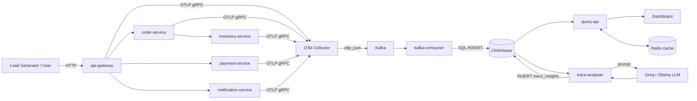

# TraceLens — Detailed Project Overview

This document explains **what TraceLens actually does, why each piece exists, and
exactly where it's implemented.** Read [`README.md`](./README.md) for the pitch and
architecture diagrams, and [`running-guide.md`](./running-guide.md) for how to run it.
This file is the "walk through the code with me" version.

---

## 1. The big picture

TraceLens simulates a small e-commerce checkout system (5 microservices) and wires it
up to a **complete, self-hosted observability pipeline** — the same shape of system
that Datadog, Honeycomb, or New Relic sell as SaaS. Every request that flows through
the checkout services gets traced, the traces flow through a real message queue into a
columnar analytics database, a REST API and dashboard let you explore that data, and a
background worker uses an LLM to automatically explain *why* a request failed.

The point of the project is the **pipeline**, not the store. The checkout flow is just
a realistic traffic generator — it exists so there's something worth observing.

Every arrow above is a real network call between real containers — nothing here is
mocked or simulated except the payment gateway and SMTP server (by design, so the demo
needs zero external credentials besides an optional free Groq key).

---

## 2. The application plane — a fake checkout, on purpose

**Intuition:** you can't observe a system with no traffic. These five services exist
purely to generate realistic, occasionally-failing, multi-hop requests to trace.

### `api-gateway` — the front door
**Where:** [`services/api-gateway/app.js`](./services/api-gateway/app.js)

The single entry point. `GET /products` proxies to `inventory-service`. `POST
/checkout` is the interesting one — it's a **saga**: it calls `order-service` to create
an order, then `payment-service` to charge it, then `order-service` again to mark it
paid, then `notification-service` to send a confirmation. If any hop fails, the whole
chain aborts and returns an error — this is exactly the kind of multi-service failure
that's hard to debug without tracing, which is the point.

Has a permissive JWT middleware (`authenticate`) that falls back to a mock user if no
`Authorization` header is present — deliberately loose, since this is a tracing demo,
not an auth demo.

### `order-service` — the source of truth for orders
**Where:** [`services/order-service/app.js`](./services/order-service/app.js)

`POST /orders` calls `inventory-service` to reserve stock and compute the total, then
inserts a `pending` row into Postgres. `PUT /orders/:id/pay` flips it to `paid`. Wraps
its work in a manual OTel span (`create_order`) so the trace shows the business
operation, not just the raw HTTP call.

### `inventory-service` — stock and pricing
**Where:** [`services/inventory-service/app.js`](./services/inventory-service/app.js)

Owns the product catalog and stock counts in Postgres. `POST /reserve` does a
`SELECT ... FOR UPDATE` row lock, decrements stock, and computes the order total inside
a transaction. Has a **10% intentional random failure** (`Math.random() < 0.1`) to
simulate a flaky downstream dependency — this is the chaos injection that produces
error traces for the AI worker to analyze. It's not a bug; it's the point.

### `payment-service` — charges the card
**Where:** [`services/payment-service/app.js`](./services/payment-service/app.js)

Same 10% simulated failure pattern. If real Razorpay credentials are set in
`infra/.env`, it calls the real Razorpay sandbox API; otherwise it simulates a 300ms
delay and returns a fake transaction ID. This means the demo works with zero payment
credentials by default.

### `notification-service` — sends the confirmation
**Where:** [`services/notification-service/app.js`](./services/notification-service/app.js)

Same pattern again: real Gmail SMTP send if credentials are provided, simulated delay
otherwise. Same 10% failure injection.

### The shared instrumentation layer
**Where:** [`services/tracing.js`](./services/tracing.js)

This is the file that actually makes all five services observable. It's loaded via
Node's `--import ./tracing.js` flag *before* each service's `app.js` runs (see the
`command:` lines in `infra/docker-compose.yml`), so instrumentation is active before a
single line of application code executes.

It sets up three OTel pipelines, all exporting to the Collector over gRPC:
- **Traces** — `OTLPTraceExporter` + `getNodeAutoInstrumentations()`, which
  auto-instruments Express, `pg`, HTTP client calls, DNS lookups, etc. — this is why you
  see spans like `tcp.connect` and `pg-pool.connect` in the trace waterfall without any
  app code asking for them.
- **Metrics** — `OTLPMetricExporter` via `PeriodicExportingMetricReader` (exports every
  10s) — captures Node runtime metrics and HTTP server duration histograms.
- **Logs** — `LoggerProvider` + `OTLPLogExporter`, sharing one `Resource` (service name +
  environment) with the trace/metric providers so all three signals agree on which
  service they came from. Exports a small `logError()` helper that each service's
  `catch` block calls alongside its `console.error`, tagged with the active span's
  trace/span ID — this is what correlates a log line back to the trace that produced it.

---

## 3. The ingestion plane — getting spans out of the app and into storage

**Intuition:** services can't write directly to the database — under load that would
mean every request pays the latency of a database write, and a database hiccup would
take down the whole app. So telemetry is decoupled from the request path: services just
fire-and-forget UDP-like gRPC calls to a local collector, which batches and buffers
everything downstream.

### OTel Collector
**Where:** [`collector/otelcol-config.yaml`](./collector/otelcol-config.yaml)

Receives OTLP over gRPC (`:4317`) and HTTP (`:4318`) from all five services. Pipeline:
`memory_limiter` (caps at 256MiB, protects itself from OOM) → `batch` (groups up to
1000 spans / 5s) → `resource` (stamps `service.namespace=observability-platform` onto
everything) → exports to three separate Kafka topics: `otel.traces`, `otel.metrics`,
`otel.logs`, encoded as `otlp_json`.

### Kafka + Zookeeper
**Where:** `infra/docker-compose.yml` (`kafka`, `zookeeper` services — off-the-shelf
Confluent images, no custom code)

**Intuition:** this is the shock absorber. If ClickHouse is briefly slow or the
consumer restarts, spans queue up in Kafka instead of being dropped or blocking the
Collector. It's the same pattern real observability vendors use to survive traffic
spikes without losing data.

### `kafka-consumer` — the bridge from queue to database
**Where:** [`kafka-consumer/index.js`](./kafka-consumer/index.js) (Kafka consumer loop,
batching, SQL INSERT building) and
[`kafka-consumer/otlp-parser.js`](./kafka-consumer/otlp-parser.js) (all the pure OTLP
parsing/escaping logic, pulled out into its own module specifically so it's unit
testable without a live Kafka/ClickHouse connection — see
[`otlp-parser.test.js`](./kafka-consumer/otlp-parser.test.js))

This is the one piece of true "glue" infrastructure code in the whole project. It:
1. Subscribes to all three Kafka topics as consumer group `otel-consumer-group`.
2. Parses each OTLP JSON message — `parseTraceMessage`, `parseMetricsMessage`,
   `parseLogsMessage` in `otlp-parser.js` — walking the nested
   `resourceSpans → scopeSpans → spans` (or the metrics/logs equivalent) structure into
   flat row objects. Metrics get special handling: gauge/sum data points become one row
   each, but histogram data points (like HTTP duration) get expanded into `.sum`,
   `.count`, `.min`, `.max` rows since ClickHouse's `metrics` table only has a single
   `Value` column.
3. Batches rows (100 at a time or every 5s, whichever comes first) and builds a raw SQL
   `INSERT` statement, escaping every string value by hand (`escSql`) and converting
   OTLP attribute arrays into ClickHouse `map(...)` expressions
   (`attributesToMapSql`) — always using the `map(...)` function form, never the bare
   `{}` literal, because ClickHouse's batch-insert parser breaks if a batch mixes both
   forms across rows (a real bug that was hit and fixed during development of this
   project — see the code comment above `attributesToMapSql`).
4. POSTs the finished SQL directly to ClickHouse's HTTP interface (`:8123`).

---

## 4. The storage plane — where telemetry lives

### ClickHouse
**Where:** [`infra/clickhouse/init.sql`](./infra/clickhouse/init.sql)

**Intuition:** traces are enormous in volume and almost never updated after being
written (append-only, time-ordered) — exactly the workload columnar OLAP databases like
ClickHouse are built for, and a terrible fit for a row-store like Postgres at scale.

Tables:
- **`traces`** — one row per span. `ORDER BY (ServiceName, StartTime)` and
  `PARTITION BY toYYYYMMDD(StartTime)` so queries filtered by service+time (the common
  case) skip most of the data on disk. 30-day TTL.
- **`metrics`** — one row per data point (`ServiceName`, `MetricName`, `Value`,
  `Timestamp`). 7-day TTL.
- **`logs`** — one row per log record, with `TraceId`/`SpanId` columns so a log line can
  be joined back to its trace. 14-day TTL.
- **`trace_insights`** — one row per LLM analysis (root cause, recommendation,
  severity) keyed by `TraceId`.

Two materialized views do the heavy lifting for the dashboard's Metrics page:
- **`service_latency_mv`** — an `AggregatingMergeTree` that incrementally maintains
  `quantileState`/`countState`/`sumState` per service per minute *as data is inserted*,
  so computing P50/P95/P99 never requires scanning raw spans.
- **`service_latency`** — a thin view that `quantileMerge`s the above into actual
  numbers on read. This two-stage pattern (state table + merge view) is the standard
  ClickHouse idiom for cheap percentiles at scale.

Two plain views compute the other dashboard pages on the fly:
- **`service_dependencies`** — self-joins `traces` on `ParentSpanId = SpanId` within the
  last hour to build the service graph (who calls whom, how often, how slow, how many
  errors).
- **`error_traces`** — groups spans by `TraceId` where `StatusCode = 2`, producing the
  error feed.

### Redis
**Intuition:** the service graph and metrics queries are expensive (joins/aggregations
over the last hour of data) but don't need to be real-time-fresh. `query-api` caches
results with a short TTL (30s for the service graph, 300s for individual trace detail)
so repeated dashboard polling doesn't re-run the same ClickHouse query every few
seconds.

---

## 5. The control plane — turning stored data into answers

### `query-api`
**Where:** [`query-api/index.js`](./query-api/index.js) (routes, caching) and
[`query-api/helpers.js`](./query-api/helpers.js) (pure `escSql`/`resolveWindow` helpers,
unit tested in [`helpers.test.js`](./query-api/helpers.test.js))

A plain Express REST API — the only thing the dashboard talks to. Every route builds a
SQL string by hand (same `escSql` escaping pattern as `kafka-consumer`), POSTs it to
ClickHouse with `FORMAT JSON` appended to the body (the modern ClickHouse HTTP
convention — see the code comment in `queryClickHouse()` for why the older `?format=`
URL-param style breaks on ClickHouse 24.x), optionally through the Redis cache, and
returns JSON.

Routes: `/api/traces`, `/api/traces/:id` (full span list for one trace),
`/api/services` (dependency graph), `/api/metrics`, `/api/alerts` (latency/error
anomalies), `/api/insights` + `/api/insights/:id`, `/api/error-traces`.

### `trace-analyser` — the AI root cause worker
**Where:** [`query-api/workers/trace-analyser.js`](./query-api/workers/trace-analyser.js)

**Intuition:** staring at a stack trace tells you *what* broke; it doesn't tell you
*why*, especially across five services. This worker automates the first pass of
incident triage.

Every 60 seconds it:
1. Queries ClickHouse for error traces (`StatusCode = 2`) from the last 5 minutes that
   don't already have a row in `trace_insights`.
2. For each one, builds a prompt (`buildPrompt`) listing every span in the trace with
   its duration and status, and asks an LLM (Groq's `llama-3.1-8b-instant` by default,
   or a local Ollama model, or a canned `mock` response for offline dev) to return
   strict JSON: root cause, impacted services, severity, and a recommended fix.
3. Writes the parsed result into `trace_insights`, which `query-api`'s `/api/insights`
   route then serves straight to the dashboard's AI Insights page.

This is a genuinely useful pattern beyond the demo: it's the same shape as production
AIOps tooling (e.g. Datadog Watchdog, Honeycomb's BubbleUp) — turn "a trace has an
error" into "here's probably why, and here's what to do about it" with zero human
involvement.

---

## 6. The presentation plane — the dashboard

**Where:** [`dashboard/src/`](./dashboard/src/) — React 19 + Vite + TypeScript +
TailwindCSS 4 + Recharts (charts) + ReactFlow (service graph)

**Intuition:** none of the above matters if a human can't look at it. The dashboard is
a thin read-only client — it holds no business logic, it just polls `query-api` every
10–15 seconds and renders what comes back.

- [`src/lib/api.ts`](./dashboard/src/lib/api.ts) — every fetch function
  (`fetchTraces`, `fetchInsights`, etc.) plus row-mapper functions (`mapTrace`,
  `mapInsight`, ...) that normalize ClickHouse's PascalCase column names
  (`TraceId`, `ServiceName`) into the camelCase shape the React components expect.
  This is the one seam where the frontend absorbs the backend's naming convention
  instead of the other way around.
- [`src/pages/Dashboard.tsx`](./dashboard/src/pages/Dashboard.tsx) — KPI tiles, a
  live requests-per-minute sparkline, the 5 most recent AI insights, a recent-errors
  feed.
- [`src/pages/Traces.tsx`](./dashboard/src/pages/Traces.tsx) — filterable trace
  table; selecting a row fetches and renders the full span waterfall for that trace.
- [`src/pages/Services.tsx`](./dashboard/src/pages/Services.tsx) — the ReactFlow
  dependency graph built from `/api/services`; edges are colored red when average
  latency exceeds 500ms.
- [`src/pages/Metrics.tsx`](./dashboard/src/pages/Metrics.tsx) — P50/P95/P99 latency,
  RPS, and error-rate charts per service, plus the anomaly alert list.
- [`src/pages/AiInsights.tsx`](./dashboard/src/pages/AiInsights.tsx) — the full,
  filterable list of LLM-generated incident analyses.
- [`src/components/layout/Sidebar.tsx`](./dashboard/src/components/layout/Sidebar.tsx) /
  [`Layout.tsx`](./dashboard/src/components/layout/Layout.tsx) — the app shell and
  navigation; this is where the "TraceLens" branding and color theme live.

---

## 7. Walking through one request, end to end

To tie it all together, here's exactly what happens for one `POST /checkout` call:

1. **Client → `api-gateway`.** A W3C `traceparent` header is created (by
   auto-instrumentation) if one doesn't already exist.
2. **`api-gateway` → `order-service` → `inventory-service`.** Each hop propagates
   `traceparent` manually in the request headers (see the explicit `headers:
   { traceparent: ... }` in each `axios` call) so all three services' spans share one
   `TraceId`. `inventory-service` locks + decrements stock in Postgres.
3. **`api-gateway` → `payment-service`.** Same trace, new span. ~10% chance of a
   simulated failure here.
4. **`api-gateway` → `order-service`** again, to mark the order paid.
5. **`api-gateway` → `notification-service`.** Simulated (or real) email send.
6. **Throughout all of this**, each service's `tracing.js`-installed SDK is
   batching spans/metrics in memory and exporting them over gRPC to the OTel Collector
   every few seconds — completely decoupled from the request/response cycle above, so
   none of this instrumentation adds latency to the user-facing response.
7. **The Collector** batches everything from every service and pushes it onto three
   Kafka topics.
8. **`kafka-consumer`** picks the messages off Kafka, parses them, and writes rows into
   ClickHouse's `traces`/`metrics`/`logs` tables.
9. **If any span in that trace had `StatusCode = 2`**, `trace-analyser` picks it up on
   its next 60-second cycle, asks an LLM to explain it, and stores the result.
10. **The dashboard**, polling `query-api` every 10–15 seconds, will show the new
    request in the traces table, its effect on the latency/error charts, its edges in
    the service graph, and — within a minute — an AI-generated explanation if it
    failed.

Nothing in steps 7–10 is on the critical path of the user's checkout request — that's
the entire architectural point of decoupling telemetry from the application via a
message queue.
